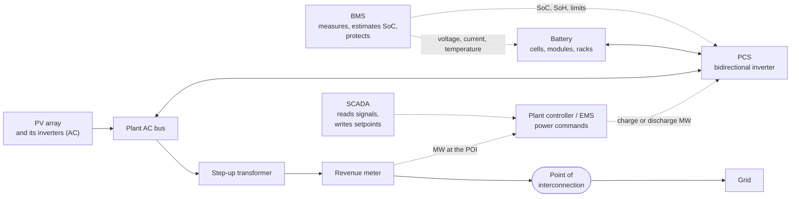

# Solar plant primer, part 2: the battery

Written 2026-10-06, right before the battery model (ADR 0014 decision 8). Part 1 ([01-solar-plant-primer.md](01-solar-plant-primer.md))
follows sunlight to the grid; this part adds a battery beside it. Every term is explained before it is named; the glossary
([glossary.md](glossary.md)) has the short form. Source tags like [S14] point to the table at the end, which says how each source
was checked. A claim with no tag is marked "general knowledge" and has no source here.

## 1. The chain in one picture

The battery sits on the same AC bus as the PV inverters, with its own inverter (the PCS). That arrangement is called
**AC-coupled**, and it is the one this project models (section 7). The solid lines carry power; the dotted lines carry
information.

## 2. Power and energy are two different ratings

A battery has two sizes, and they answer different questions [S15]:

- **Power capacity** (kW or MW): how fast it can charge or discharge. NREL describes the power capacity as the maximum rate of
  discharge the system can reach starting from a fully charged state.
- **Energy capacity** (kWh or MWh): how much energy it can hold, the maximum amount of stored energy.
- **Duration** (hours): how long it can discharge at its power capacity before it is empty. NREL's example: a battery with 1 MW of
  power capacity and 4 MWh of usable energy capacity has a storage duration of four hours [S15]. NREL's own representative
  plant uses a four-hour battery [S16].

So "2 MW / 4 MWh" means it can push 2 MW for two hours, and "4 MW / 4 MWh" would be a one-hour battery. The same number of
MWh can sit behind a small or a large inverter. SunSpec's battery model keeps the two ratings in separate points: an energy rating
(`WHRtg`) and maximum charge and discharge rates (`WChaRteMax`, `WDisChaRteMax`) [S18].

Battery sizing for this project is not decided here. It is set in the battery's ADR, after this primer.

## 3. State of charge: how full it is

**State of charge** (SoC) is how full the battery is, as a percentage. Sandia defines it as the ratio between the remaining energy
and the maximum energy capacity while cycling, and adds a point that matters for SCADA: for most storage technologies SoC cannot be
measured directly, only estimated from other measurements [S14]. That estimate is one of the jobs of the battery management
system (section 4).

Related terms, each a point in SunSpec's battery model [S18]:

- **Depth of discharge** (DoD): how much of the capacity has been used, as a percentage.
- **State of health** (SoH): the share of battery life remaining. A battery loses capacity as it ages; the simulator will not model
  that (section 8).
- **SoC limits**: the manufacturer's maximum and minimum SoC (`SoCMax`, `SoCMin`). A battery is meant to be run between them and
  not from 0 to 100 percent (general knowledge). SunSpec also has a battery state called `SOC PROTECTION` [S18].
- **Cycle count**: how many charge-and-discharge cycles it has done [S18]. NREL's FAQ lists cycle life, self-discharge, and
  state of charge among the key characteristics of battery storage [S15].

## 4. Who does what: BMS, PCS, EMS

Three systems share the work, and Sandia describes how they fit together [S14]:

- **Battery management system (BMS).** It manages the battery modules and reports operating data such as the state of charge, the
  state of health, and the cell temperature. Its monitoring measures voltage, current, and temperature and estimates SoC and SoH. It
  also protects the battery: for example, an active protection mechanism will disconnect a battery module whose voltage, current,
  or temperature limits are violated.
- **Power conversion system (PCS).** The battery stores DC; the grid is AC. The PCS is a bidirectional inverter [S16][S17]: it
  turns the battery's DC into AC when discharging and the AC into DC when charging (general knowledge for that description). NREL's
  figure of a battery plant labels it the inverter/charger [S15]. While it delivers the power it was told to, it also interfaces with
  the BMS so that none of the battery's limits are violated [S14].
- **Energy management system (EMS).** It takes the BMS's data and the PCS's data and calculates the charge or discharge power that
  it sends to the PCS as a power command [S14]. In this project the plant controller (primer part 1, section 5) plays that part for
  the battery.

The direction of flow is worth remembering: operating data goes up from the battery to the EMS, and commands go down to the PCS
[S14]. SCADA reads the data and writes the setpoints that start the commands.

Below the BMS the battery is built from cells, grouped into modules and racks (general knowledge). The simulator will treat the
whole battery as one unit.

## 5. Power limits: why the battery cannot always do what it is told

A battery has a **maximum charge rate** and a **maximum discharge rate**, and a control point for each: SunSpec's storage
controls model has `WChaMax` (maximum charge setpoint), `InWRte` (percent of the maximum charge rate), and `OutWRte` (percent of
the maximum discharge rate), and a control for charge or discharge mode (`StorCtl_Mod`) [S18]. On top of that:

- It cannot charge when it is full or discharge when it is empty. SunSpec's charge status has the values `OFF`, `EMPTY`,
  `DISCHARGING`, `CHARGING`, `FULL`, `HOLDING`, and `TESTING` [S18].
- The BMS and PCS hold the power within the battery's limits [S14].
- Real batteries usually reduce the allowed power as they approach full or empty, instead of running at full power until they
  hit the limit (general knowledge, not checked against a source). The simulator will do this on purpose, as a labelled design
  choice.

## 6. Round-trip efficiency: what comes back out

Charging and discharging both lose some energy, as heat and in the inverter (general knowledge). **Round-trip efficiency** is the
share of the energy put in that comes back out over a whole charge and discharge cycle (general knowledge; a definition in an NREL
cost report was seen only in a search excerpt). NREL's reference values for a utility-scale lithium-ion plant are 85 percent when the battery
charges from the grid and 87 percent when it charges from the PV it is coupled to, because charging from the PV avoids some AC and
DC conversions [S16]. So at 85 percent, putting 100 MWh in gets about 85 MWh back out.

For the simulator one number is enough, chosen when the model is built, with its source and a note that real values vary.

## 7. AC-coupled and DC-coupled

There are two ways to add a battery to a solar plant [S17][S16]:

- **DC-coupled:** the battery connects to the PV array's DC side and shares one bidirectional inverter. DOE says it needs one
  inverter type. NREL's default plant is built this way, and it can route PV energy that would be clipped into the battery [S16].
- **AC-coupled:** the battery has its own inverter (the PCS) and the PV has its own, and they meet on the AC side. DOE says it needs
  both inverter types, and NREL notes lower charging efficiency from the extra AC and DC conversions [S17][S16]. DOE gives a cost
  comparison: a co-located DC-coupled system costs 8 percent less than separate systems, and an AC-coupled one 7 percent less [S17].

This project models an **AC-coupled** battery (ADR 0014 decision 8). The reason is simplicity: the PV inverters stay exactly as
they are, and the battery is one more device on the AC bus. The price, following from NREL's note that DC coupling can capture
clipped energy [S16], is that an AC-coupled plant does not recover it that way. This is a choice the model makes, not a claim
that real plants are built this way.

## 8. What SCADA sees

SunSpec has public models for storage, which this project can use the way it used models 103 and 123 for inverters [S18]:

| What | Where in SunSpec | Direction |
|---|---|---|
| Energy rating, available energy, state of charge, state of health | Model 713 (DER storage capacity): `WHRtg`, `WHAvail`, `SoC`, `SoH` | Read |
| Battery details: SoC limits, depth of discharge, cycle count, charge status, battery state, max charge and discharge rates | Model 802 (battery base): `SoCMax`, `SoCMin`, `SoC`, `DoD`, `NCyc`, `ChaSt`, `State`, `WChaRteMax`, `WDisChaRteMax` | Read |
| Charge and discharge control: hold, charge, or discharge; percent of the maximum rates | Model 124 (basic storage controls): `StorCtl_Mod`, `InWRte`, `OutWRte`, `WChaMax` | Write |
| DC side power | Model 714 (DER DC measurement) | Read |

Which of these the simulator serves, and at which register addresses, is decided in the battery's ADR. The battery's power also
reaches the revenue meter: at the point of interconnection the meter sees the PV and the battery added together, with the battery's
power negative while it charges (general knowledge).

## 9. Not modeled here

The battery model (ADR 0014 decision 8) will have state of charge that rises and falls with power, a power limit that tapers near
empty and full, one round-trip efficiency, and Idle, Charge, and Discharge modes with a MW setpoint from the plant controller. It
will not model: cell temperature and cooling, aging (the state of health stays fixed), cell balancing, ramp rates, the power the
battery itself uses, or fire and safety systems [S14]. Automatic dispatch, such as charging from curtailed solar or discharging in
the evening, waits for the Phase 3 scenarios.

## Sources and how each was checked

Checked 2026-10-06. NREL's documents are served from `nlr.gov`; the older `nrel.gov` addresses did not resolve from this
machine. Two PDFs could not be read by the fetch tool as documents, so their text was extracted with Python's standard library and
read. A search engine summary of patents also came up for BMS and PCS; it was not used.

| Tag | Source | How checked |
|---|---|---|
| S14 | Nguyen, Byrne, Rosewater, Trevizan, Sandia National Laboratories, "Energy Storage Management Systems," chapter 15 of the Energy Storage Handbook (2020). https://www.sandia.gov/app/uploads/sites/163/2023/01/ESHB2020_Ch15_ESMS_Nguyen.pdf | PDF text extracted and read (about 30,000 characters, partly noisy); the BMS, PCS, EMS, SoC, and protection statements are from it |
| S15 | NREL, "Grid-Scale Battery Storage: Frequently Asked Questions" (2019, report 74426). https://docs.nlr.gov/docs/fy19osti/74426.pdf | PDF text extracted and read (about 32,000 characters, partly noisy); the power capacity, energy capacity, duration, and key-characteristics statements and the labels of its components figure are from it. Its round-trip efficiency definition was not found in the extracted text |
| S16 | NREL Annual Technology Baseline, "Utility-Scale PV-Plus-Battery" (2023). https://atb.nlr.gov/electricity/2023/utility-scale_pv-plus-battery | Page read through the fetch tool's answer to a targeted question: the 85 and 87 percent values, the DC-coupled default and the AC-coupled alternative, and the four-hour duration |
| S17 | US DOE, "Solar-Plus-Storage 101". https://www.energy.gov/cmei/systems/articles/solar-plus-storage-101 | Page read through the fetch tool: the AC and DC coupling description and the 8 and 7 percent cost figures. The page says nothing about clipping recovery |
| S18 | SunSpec model definitions 124, 713, 714, and 802. https://github.com/sunspec/models/tree/master/json | The raw JSON read directly: point names, labels, descriptions, and the symbols of the status enumerations |
