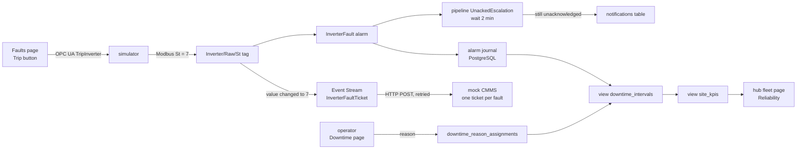

# Layer Card 4: The operations layer (faults, alarms, tickets, downtime, KPIs)

Status: written 2026-10-14, **after the build**, so each claim says how it was checked. The decisions are in
[ADR 0017](../adr/0017-phase3-fault-injection-by-plant-controller-node.md) to
[ADR 0021](../adr/0021-phase3-site-kpis-and-availability.md), and the evidence is findings 72 to 81 in
[the Phase 2 findings](../spikes/phase2-findings.md). The layer below this one is [Layer Card 3](03-fleet-and-templating.md).

## Why this layer exists

A plant that only shows numbers is a screen. A plant that you can run needs to notice when something is wrong, make sure a person
notices too, get a repair started, record how long the equipment was down and why, and turn that into a few numbers a manager can
judge. This layer does that for one kind of fault, an inverter trip, and does it end to end. It owns the alarm, the journal that
records it, the escalation, the repair ticket, the downtime record, and the KPIs. It owns no plant data: the fault itself begins in
the simulator, like every other number.

## The pieces and the vocabulary

| Term | What it is here |
|---|---|
| **Fault** | An order that makes the simulated plant misbehave. The Trip buttons on the Faults page write `TripInverter` on the plant controller (OPC UA); the simulator then stops that inverter and its status register reads 7 (Fault) over Modbus. |
| **Alarm** | A rule on a tag. `InverterFault` watches each inverter's status and goes **Active** when it equals 7. A person **acknowledges** it (has seen it); it **clears** when the status leaves 7. These are separate: a cleared alarm may still be unacknowledged. |
| **Alarm journal** | A record of every alarm event, written to PostgreSQL. One alarm leaves up to three rows (Active, Acknowledged, Cleared) that share one `eventid`. Each gateway writes its own pair of tables. |
| **Alarm pipeline** | A small flowchart that starts a fresh copy for each alarm event. Ours is START, a 2-minute Delay, then a Script. Its **dropout condition** (acknowledged, cleared, or shelved) ends it early, so no check block is needed. |
| **Event Stream** | An Ignition module that turns events into actions in stages: a **source** (what wakes it), a **filter** (does this one matter?), a **transform** (reshape it), **handlers** (do something with it). |
| **CMMS** | A maintenance system, where repair work is tracked. Ours is a small stand-in container; the Event Stream posts a **ticket** to it. |
| **Idempotent** | Doing it twice has the same effect as doing it once. The CMMS makes one ticket per fault, so a retried delivery cannot make a second. |
| **Downtime** | A stretch when equipment that could produce does not. For us: an inverter fault from Active to Cleared. |
| **Reason code** | Why it was down (inverter fault, grid outage, weather, and so on). Each code says whether it counts against availability. |
| **Availability** | The share of time the inverters were able to produce. Ours is a simplification: time-based over 24 hours, counting only reasons that count against it. |
| **View (SQL)** | A saved query that behaves like a table and holds no data itself. |

## Shape

## How one fault travels

Measured on 2026-10-13 (findings 75, 78, 79, 80):

1. You press a Trip button. The plant controller holds the order and the simulator stops the inverter. The status register reads
   7, and the inverter's card shows Fault at 0 kW.
2. The gateway raises `InverterFault` and the journal writes an Active row. The Event Stream's source sees the status change
   about 0.1 s later.
3. The stream's filter keeps only value 7; the transform builds the ticket (site from the gateway's name, equipment from the tag
   path, fault start from the tag's timestamp); the HTTP handler posts it to the CMMS. The ticket arrived 0.13 s after the event on
   site1 and 0.53 s on site2. If the CMMS is down, the handler retries up to 60 times, about a second apart plus the few seconds each
   failed connection takes; a ticket arrived 28 s after a fault with the CMMS stopped for about 20 s, once, with the true start
   time in it.
4. In parallel, the pipeline waits 2 minutes. If nobody acknowledged (and it has not cleared), it writes a row to `notifications`
   at 2:00.04. An acknowledge or a clear before that stops it, and no row is written.
5. Later, an operator picks a reason on the Downtime page; it is saved at once. The view `downtime_intervals` builds one row per
   fault from the journal (start, end, duration, reason), and `site_kpis` turns those into fault events, mean time to acknowledge,
   mean time active, and availability. The hub's fleet page shows them per site, with n/a for sites that have no alarm journal.

## What exists today

| Piece | State |
|---|---|
| Inverter trip (simulator node, status 7) | Built and run on site1 and site2 (ADR 0017, finding 72) |
| `InverterFault` alarm and the journal, one table pair per gateway | Built by hand and by `generator.connections`; run on both sites |
| Escalation pipeline `UnackedEscalation`, `notifications` table | Built (Wes by hand); run on both sites (ADR 0018, findings 73 to 75) |
| Event Stream `InverterFaultTicket` and the mock CMMS container | Built (Wes by hand, with the agent's scripts); run on both sites, with retry (ADR 0019, findings 76 to 79) |
| Reason tables, the `downtime_intervals` view, the Downtime page | Built (the agent wrote the SQL and the page); run on both sites (ADR 0020, finding 80) |
| `sites` table, `site_kpis` view, the Reliability section on the hub | Built; every number was recomputed independently and matched (ADR 0021, finding 81) |
| Applying the `sql/` files after a rebuild | By hand only; a script is planned |

## How it fails (and what we do about it)

Each of these was seen, or follows directly from what was seen.

| What you see | Likely cause | Where to look |
|---|---|---|
| A trip makes no ticket and no Logger line, every stage count is 0 | The stream is saved as **Disabled** (this happened twice during the retry tests) | The stream's state in `GET /data/event-stream/api/v1/streams/details/site`, and its saved `enabled` flag |
| The stream shows RUNNING and stages GOOD, but nothing reaches the handlers | A script error in the Filter or Transform drops every event and only counts it | The stage's error list (the Status icon in the stream editor) |
| The whole stream is FAULTED and the source receives nothing | A handler setting does not parse, for example text without double quotes in an expression field | The gateway log: "Failed to start Event Stream due to faulted stage" |
| `ConnectException` in the HTTP handler, no ticket | The CMMS is down or unreachable; with retry the ticket follows when it returns, within the retry window | `docker.exe compose ps cmms`; the handler's error list |
| A ticket is lost although retry is on | The outage outlasted the retry window, or the gateway restarted while retries waited (they are held in memory) | The CMMS page; ADR 0019 |
| The pipeline overview still lists an instance after you acknowledged | It stays listed until its delay ends, then ends without running the script | `GET /data/alarm-notification/api/v1/pipelines`; do not count instances as unacknowledged alarms |
| No `notifications` row although the alarm sat unacknowledged | The pipeline was not attached to the alarm, or the database write failed (the script logs an error and does not retry) | The alarm's Active Pipeline on the Inverter UDT; the gateway log |
| A fault shows `UNASSIGNED` for ever | Nobody picked a reason | The Downtime page |
| A KPI looks too low or too high | One long old test fault dominates a short window, or a fault with no reason yet counts against availability | `downtime_intervals`, and the reason codes' flags |
| A value saved in Designer is not what runs | A typed number only reaches the gateway after its field loses focus | A project export: read the saved config before testing |

## What it does not model or protect

- Only inverter faults. Comms loss, curtailment events, an underperformance alarm and battery faults are future work.
- Availability is time-based over all 24 hours and ignores daylight and partial losses of output; real contracts differ.
- The alarm's priority is written into the transform as High; it does not read the alarm.
- Waiting retries and pending escalations live in the gateway's memory; there is no durable queue for the ticket or the
  notification. The stream's Error Handler stage, the place for one, is empty.
- The pages have no login, so a reason is saved as chosen by "unknown", and the CMMS has no login (ADR 0004).
- The `sql/` files are applied by hand and nothing re-applies them after a rebuild.
- The journal's times are local time with no zone; the downtime view assumes America/Chicago, and the one-hour overlap when the
  clocks go back was not tested.

## Where to look yourself

- The Faults page (`/faults` on a site gateway): trip, acknowledge, clear.
- The pipeline: `GET /data/alarm-notification/api/v1/pipelines` while an alarm waits; the `notifications` table afterwards.
- The stream: the Status icon in its editor, or `GET /data/event-stream/api/v1/streams/details/site`.
- The tickets: `http://localhost:8100` (the page), `/tickets` (JSON), `/docs`.
- Downtime and KPIs: the Downtime page on a site gateway, and the Reliability section of the hub's fleet page.
